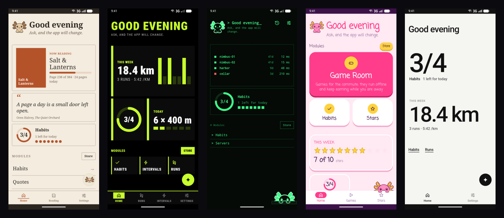

<p align="center">
  <a href="docs/promo/axiko-promo.mp4"></a>
</p>

<p align="center">English · <a href="README.ru.md">Русский</a></p>

# Axiko

**Software you finish yourself.**

Axiko is a personal Android app with a language model at its core. You say what you need, in text
or by voice, and an agent inside the app writes it: the logic, the screen, the card on Home. It
happens on the phone, without a rebuild, an update or an app store.

## The idea

An app is made once, for millions of people, and ships finished. Everyone gets the same screens.
The settings page lists the choices someone else thought to offer. If the app lacks what you need,
you wait for a release or look for another app.

Axiko ships unfinished on purpose. On day one it is a home screen, a chat and an agent that can
write the rest. A reader ends up with a reading log and a quote of the day. A runner ends up with
intervals and weekly distance. What the app becomes depends on who holds it, and no two copies
stay alike for long.

## Principles

- **It is yours.** Everything the app is made of lives as files in a working folder on your phone:
  screens, modules, themes, the menu, the mascot, the agent's own prompt and tools. You can read
  them, edit them, back them up and carry them to another phone.
- **Everything can change.** The agent edits the same files the app runs from, so there is no fixed
  list of options. The chat, Home and Settings are as editable as any module.
- **No gatekeeper.** A new feature does not wait for a release. Modules come from the agent, from
  you, or from any repository you choose to connect.
- **Every change can be undone.** The shell takes a snapshot before each turn of the agent. History
  shows what changed, file by file, and rolls it back. Safe mode starts the factory interface if
  the edited one breaks. An encrypted backup holds everything personal in one file.
- **Your model, your data.** Any OpenAI-compatible provider works, and so do models that run on the
  phone. Provider keys and stored secrets stay with the shell: scripts and the model never see
  their values. What the agent reads goes to the model you chose, so pick an on-device model for
  what must not leave the phone.

## How it works

1. **You ask**, in the chat or by voice: "Make a habit tracker with daily marks."
2. **The agent plans and writes.** It is a loop around the model you chose, with tools for files,
   code and the phone. It asks when it is unsure, then writes a module: `module.json`, the logic,
   a screen, a card for Home.
3. **It checks its own work.** It opens the new screen for itself, reads the console, looks at a
   screenshot and fixes what is broken.
4. **The screen is on Home.** If you do not like it, say so, or roll the turn back.

Under that there are three layers:

| Layer | Where | Who changes it |
|---|---|---|
| Shell: WebView, JavaScript engine, agent loop, voice, system services | the APK (Kotlin) | developers, rarely |
| Factory copy of the working folder: screens, library, the agent's prompt | inside the APK | developers |
| Working folder on the device: the same, plus your modules, agents and themes | on the phone | the agent and you, all the time |

Screens are plain HTML shown in a WebView straight from the working folder, with no build step.
Logic runs in Rhino, a JavaScript engine that can call Android classes directly, so a module can
reach anything the phone offers. The agent loop and the safety net (snapshots, safe mode, secrets)
live in the shell, where the agent cannot edit them.

More detail: [docs/architecture.md](docs/architecture.md) (in Russian).

## What it can do today

- **Build things.** Screens, modules, games, routines that run on a schedule or on an event, other
  agents with their own chats and models, and new tools for itself.
- **Sense the phone.** Read and operate the screen of other apps, read notifications and reply in
  them, act as the system assistant, float a button over other apps. You turn each of these on
  yourself in system settings.
- **Listen and speak.** Speech recognition on the device (GigaAM v3, a Russian-language model),
  speech through a provider or a voice on the phone, and a name you can call it by.
- **Work like a colleague.** It asks clarifying questions as a form, proposes a plan and marks its
  steps, runs parts of a job in parallel, and keeps changes as a draft until you decide.
- **Reach outside.** Web search and page reading, MCP servers, sign-in to services over OAuth,
  long-term memory with search by words and by meaning.
- **Stay offline.** On-device models (Gemma, Qwen and others through LiteRT-LM) and a Linux
  environment for Python, Node and ffmpeg.
- **Open on a computer.** A web hub served by the phone on your local network: your modules, the
  chat and a studio with a file editor, a preview and a log. The phone is also an MCP server for
  agents on other machines.
- **Install what others made.** A store of modules and games from the repositories you connect,
  with updates, rollback and mods that change another package.
- **Speak your language.** The interface ships in Russian and English. The agent can add another.

## Make it yours

<p align="center">
  
</p>

These five phones run the same build. The difference is a theme file, a menu file, a mascot file
and a few modules. Ask the agent for any of it, or change it yourself in Settings:

- **Themes.** A theme is a file with color tokens and any CSS, so it sets colors, typefaces,
  shapes, spacing and layout. Six ship with the app.
- **Home.** Which cards are shown, in what order and how wide.
- **Menu.** The items, their icons and the screens they open, including screens of your modules.
  The menu can also be hidden.
- **Mascot.** Axiko the axolotl wears the theme's colors. Recolor it, give it other phrases,
  replace it with a character of your own, or turn it off. The chat button has three looks.
- **Details.** The floating button, the launcher icon, the interface scale, the language.
- **The agent.** Its prompt, tools and memory, the model for each role, and other agents beside it.
- **The screens themselves.** If a theme is not enough, ask for the chat or Home to work
  differently.

## Build and share modules

A module is a folder: `module.json`, a screen in `ui/index.html`, and when needed the logic in
`main.js`, a card for Home and dictionaries for other languages. There is no build step. You can
ask the agent to make one, edit it in the web hub's studio, or write it by hand.

Two rules keep modules usable by other people:

- A module works fully in English. Other languages, Russian included, are welcome and optional.
- A module colors itself with the kit's variables, so every theme suits it.

The agent's own reference is the best guide to what a module can do:
[handbook.md](app/src/main/assets/factory/agent/handbook.md) and
[api.md](app/src/main/assets/factory/agent/api.md) (in Russian).

When a module is useful to you, it is probably useful to someone else. Share it:

- **The official catalog** is [Billerens/axiko-store](https://github.com/Billerens/axiko-store):
  about forty modules and games at the moment. Its README describes the package layout, versions and
  listings in several languages.
- **Your own repository.** Any HTTPS address or GitHub repository with an `index.json` is a store
  that others can connect in their app. The format is in
  [repository-format-v1.md](docs/marketplace/repository-format-v1.md), and the tools that build a
  catalog are in [scripts/store](scripts/store).
- **Mods.** Took someone's package and changed it? Publish the change as a
  [mod](docs/marketplace/mods.md) that lays over the original.

Tell people about Axiko, show what yours has turned into, and publish what you built.

> [!WARNING]
> **Trust is yours to give.** Axiko is a community. Anyone can publish a module or run a
> repository, and not everyone is honest.
>
> **An installed module is not sandboxed.** It runs with everything Axiko itself can do on your
> phone: your files and personal data, the network, and every permission you granted, which may
> include notifications and the screen of other apps. The permissions a package declares inform
> you; they do not restrict it. A malicious module could send your data out, read your messages,
> act in other apps in your name, or spend your model budget.
>
> What Axiko does before an install:
> - checks the package's structure and the hash of the archive and of every file;
> - shows a plan with what will change, what the package can reach and whether it starts by itself;
> - runs none of the package's code during the install;
> - lets the agent review the code against a [fixed list of rules](docs/marketplace/review-rules.md):
>   a plain violation bans that release, a suspicion is shown to you with the file and the line;
> - takes a snapshot, so the install can be rolled back.
>
> **A passed review is not proof of safety.** The reviewer is a language model. It can miss things
> and it can be fooled.
>
> What you should do:
> - install only from sources you trust, and treat an unknown repository as you would an unknown
>   APK;
> - read the plan and the warnings instead of tapping through them;
> - be wary of a module that wants notifications, the screen, the shell, secrets or the network
>   without an obvious reason;
> - keep a backup, and roll back or remove a module that behaves oddly.
>
> The details are in [implementation.md](docs/marketplace/implementation.md) (in Russian).

## Get started

There is no build in an app store. You build Axiko and install it over `adb`. You need a phone with
Android 11 or newer, the Android SDK (platform 36) and JDK 17 or newer.

```powershell
scripts\fetch-libs.ps1                 # once: the speech recognition library (49 MB)
.\gradlew.bat assembleDebug -Pphone    # arm64 only; drop -Pphone for an emulator
adb install -r app\build\outputs\apk\debug\app-debug.apk
```

Then open Settings in the app and follow the setup steps: add a model provider (any
OpenAI-compatible address and its key) or download a model to the phone.

Building, updating an older install, tests and scripts are covered in
[docs/development.md](docs/development.md) (in Russian).

## Docs

Most documents are in Russian for now.

| Topic | Document |
|---|---|
| Layers, agents, voice, senses, chat | [docs/architecture.md](docs/architecture.md) |
| Build, install, tests, scripts | [docs/development.md](docs/development.md) |
| Modules and games, with a page for each | [docs/modules.md](docs/modules.md) |
| Store: format, review rules, trust boundaries | [docs/marketplace](docs/marketplace) |
| Backup and moving to another phone | [docs/backup.md](docs/backup.md) |
| Web hub | [docs/web-hub.md](docs/web-hub.md) |
| Mascot, colors, wording | [docs/brand.md](docs/brand.md) |
| How this video was made | [docs/promo](docs/promo) |

## License

No license has been chosen yet, for this repository or for the store. Until one is, ask before you
reuse the code.
