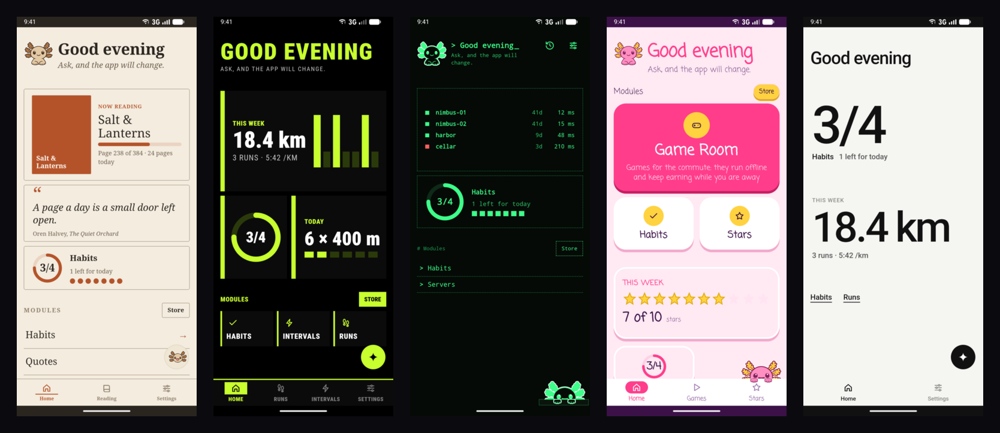

<p align="center">
  <a href="assets/promo/axiko-promo.mp4"></a>
</p>

<p align="center"><a href="README.md">English</a> · Русский</p>

# Axiko

**Программа, которую дописываете вы сами.**

Axiko — личное Android-приложение, в основе которого языковая модель. Вы говорите, что вам нужно,
текстом или голосом, а агент внутри приложения пишет это: логику, экран, карточку на главном
экране (Home). Всё происходит на телефоне, без пересборки, обновления и магазина приложений.

## Идея

Приложение делают один раз, для миллионов людей, и выпускают готовым. У всех одни и те же экраны.
В настройках только те варианты, которые кто-то другой догадался предложить. Если нужного нет,
остаётся ждать релиза или искать другое приложение.

Axiko намеренно выходит недоделанным. В первый день это главный экран, чат и агент, который умеет
дописать остальное. Читатель получает дневник чтения и цитату дня. Бегун получает интервалы и
недельную дистанцию. Чем станет приложение, зависит от того, в чьих оно руках, и двух одинаковых
копий скоро не остаётся.

## Принципы

- **Оно ваше.** Всё, из чего состоит приложение, лежит файлами в рабочей папке на вашем телефоне:
  экраны, модули, темы, меню, маскот, собственный промпт и инструменты агента. Их можно читать,
  править, сохранять в резервную копию и переносить на другой телефон.
- **Менять можно всё.** Агент правит те же файлы, из которых приложение запускается, поэтому
  фиксированного списка опций нет. Чат, главный экран и настройки редактируются так же, как любой
  модуль.
- **Без привратника.** Новая возможность не ждёт релиза. Модули приходят от агента, от вас или из
  любого репозитория, который вы подключите.
- **Любое изменение можно отменить.** Оболочка делает снимок перед каждым ходом агента. История
  показывает, что изменилось, файл за файлом, и откатывает изменения. Безопасный режим запускает
  заводской интерфейс, если изменённый сломался. Зашифрованная резервная копия хранит всё личное в
  одном файле.
- **Ваша модель, ваши данные.** Подойдёт любой OpenAI-совместимый провайдер, а также модели,
  которые работают на самом телефоне. Ключами провайдеров и секретами самой оболочки управляет
  оболочка: обычные API для скриптов и модели не возвращают их значения. То, что агент читает, уходит выбранной вами модели, так
  что для всего, что не должно покидать телефон, выбирайте модель на устройстве.

## Как это работает

1. **Вы просите** в чате или голосом: «Make a habit tracker with daily marks» (сделай трекер
   привычек с отметками по дням).
2. **Агент планирует и пишет.** Это цикл вокруг выбранной вами модели, с инструментами для файлов,
   кода и телефона. Если что-то неясно, он спрашивает, а потом пишет модуль: `module.json`,
   логику, экран, карточку для главного экрана.
3. **Он проверяет свою работу.** Сам открывает новый экран, читает консоль, смотрит на скриншот и
   исправляет то, что сломано.
4. **Модуль появляется на главном экране.** Если он вам не нравится, скажите об этом или откатите
   ход.

Под этим три слоя:

| Слой | Где | Кто меняет |
|---|---|---|
| Оболочка: WebView, движок JavaScript, цикл агента, голос, системные службы | APK (Kotlin) | разработчики, редко |
| Заводская копия рабочей папки: экраны, библиотека, промпт агента | внутри APK | разработчики |
| Рабочая папка на устройстве: то же самое плюс ваши модули, агенты и темы | на телефоне | агент и вы, постоянно |

Экраны — это обычный HTML, который показывает WebView прямо из рабочей папки, без сборки.
Логика работает в Rhino, движке JavaScript, который умеет вызывать классы Android напрямую, так что
модуль дотянется до всего, что умеет телефон. Цикл агента и страховка (снимки, безопасный
режим, секреты) живут в оболочке, где агент не может их править.

Подробнее: [Architecture](docs/architecture.md) ([русский перевод](docs/architecture.ru.md)).

## Что уже умеет

- **Создавать.** Экраны, модули, игры, рутины, которые запускаются по расписанию или по событию,
  других агентов с собственными чатами и моделями и новые инструменты для себя.
- **Чувствовать телефон.** Читать экран других приложений и управлять им, читать уведомления и
  отвечать на них, работать системным ассистентом, показывать плавающую кнопку поверх других
  приложений. Каждую из этих возможностей вы включаете сами в системных настройках.
- **Слушать и говорить.** Распознавание речи на устройстве (GigaAM v3, русскоязычная модель),
  озвучка через провайдера или голосом телефона и имя, по которому его можно позвать.
- **Помогать поверх экрана.** Редактируемая панель для голоса и текста открывается над текущим
  приложением в отдельном разговоре, а задача агента может продолжиться после закрытия.
  [Руководство](docs/assistant.md) · [Русский](docs/assistant.ru.md)
- **Работать как коллега.** Задаёт уточняющие вопросы в виде формы, предлагает план и отмечает
  шаги, выполняет части работы параллельно и держит изменения черновиком, пока вы не решите.
- **Выходить наружу.** Поиск в сети и чтение страниц, MCP-серверы, вход в сервисы через OAuth,
  долговременная память с поиском по словам и по смыслу.
- **Работать без сети.** Модели на устройстве (Gemma, Qwen и другие через LiteRT-LM) и среда Linux
  для Python, Node и ffmpeg.
- **Открываться на компьютере.** Web-хаб, который телефон отдаёт по локальной сети: ваши модули,
  чат и студия с редактором файлов, предпросмотром и журналом. Телефон также служит MCP-сервером
  для агентов на других машинах.
- **Ставить чужое.** Магазин модулей и игр из подключённых вами репозиториев, с обновлениями,
  откатом и модами, которые меняют чужой пакет.
- **Говорить на вашем языке.** Интерфейс поставляется на русском и английском. Агент может
  добавить другой.

## Сделайте его своим

<p align="center">
  
</p>

На этих пяти телефонах стоит одна сборка. Разница в файле темы, файле меню, файле маскота и
нескольких модулях. Попросите об этом агента или измените всё сами в настройках:

- **Темы.** Тема — это файл с цветовыми токенами и любым CSS, поэтому она задаёт цвета, шрифты,
  формы, отступы и компоновку. Шесть тем идут вместе с приложением.
- **Главный экран.** Какие карточки показывать, в каком порядке и какой ширины.
- **Меню.** Пункты, их значки и экраны, которые они открывают, включая экраны ваших модулей.
  Меню можно и скрыть.
- **Маскот.** Аксолотль Axiko носит цвета темы. Перекрасьте его, дайте ему другие фразы, замените
  собственным персонажем или выключите. У кнопки чата три вида.
- **Мелочи.** Плавающая кнопка, значок приложения, масштаб интерфейса, язык.
- **Агент.** Его промпт, инструменты и память, модель для каждой роли и другие агенты рядом с ним.
- **Сами экраны.** Если темы мало, попросите, чтобы чат или главный экран работали иначе.

## Делайте модули и делитесь ими

Модуль — это папка: `module.json`, экран в `ui/index.html` и, когда нужно, логика в `main.js`,
карточка для главного экрана и словари для других языков. Сборки нет. Можно попросить агента
сделать модуль, править его в студии web-хаба или написать вручную.

Два правила, благодаря которым модулями могут пользоваться другие люди:

- Модуль полностью работает на английском. Другие языки, в том числе русский, приветствуются, но
  не обязательны.
- Модуль красится переменными кита, поэтому подходит к любой теме.

Начните с основных английских [соглашений для модулей](docs/modules.md),
[контрактов оболочки](docs/native-contracts.md) и [правил разработки игр](docs/game-development.md).
Рядом доступны дополнительные русские версии. В приложении также остаются подробные русские справки агента:
[handbook.md](app/src/main/assets/factory/agent/handbook.md) и
[api.md](app/src/main/assets/factory/agent/api.md).

Если модуль полезен вам, он, скорее всего, полезен и кому-то ещё. Поделитесь им:

- **Официальный каталог** — [Billerens/axiko-store](https://github.com/Billerens/axiko-store):
  сейчас в нём около сорока модулей и игр. Его README описывает устройство пакета, версии и
  описания на нескольких языках.
- **Собственный репозиторий.** Любой HTTPS-адрес или репозиторий GitHub с `index.json` — это
  магазин, который другие могут подключить в своём приложении. Формат описан в
  [repository-format-v1.md](docs/marketplace/repository-format-v1.md), а инструменты для сборки
  каталога лежат в [scripts/store](scripts/store).
- **Моды.** Взяли чужой пакет и изменили его? Опубликуйте изменение как
  [мод](docs/marketplace/mods.md), который накладывается поверх оригинала.

Расскажите об Axiko, покажите, во что превратилась ваша копия, и публикуйте то, что сделали.

> [!WARNING]
> **Доверие выдаёте вы сами.** Axiko — сообщество. Любой может опубликовать модуль или завести
> репозиторий, и не все честны.
>
> **Установленный модуль не изолирован.** Он работает со всем, что умеет сам Axiko на вашем
> телефоне: с вашими файлами и личными данными, с сетью и со всеми разрешениями, которые вы
> выдали, а это могут быть уведомления и экран других приложений. Разрешения, которые заявляет
> пакет, лишь информируют вас, но ничего не ограничивают. Вредоносный модуль мог бы отправить ваши
> данные наружу, прочитать ваши сообщения, действовать в других приложениях от вашего имени или
> потратить бюджет вашей модели.
>
> Что Axiko делает перед установкой:
> - проверяет структуру пакета, а также хеш архива и каждого файла;
> - показывает план: что изменится, до чего пакет может дотянуться и запускается ли он сам;
> - не запускает код пакета во время установки;
> - поручает агенту проверить код по [фиксированному списку правил](docs/marketplace/review-rules.md):
>   явное нарушение отправляет этот выпуск в бан, а подозрение показывается вам с файлом и строкой;
> - делает снимок, чтобы установку можно было откатить.
>
> **Пройденная проверка не доказывает безопасность.** Проверяет языковая модель. Она может
> что-то пропустить, и её можно обмануть.
>
> Что нужно делать вам:
> - ставьте только из источников, которым доверяете, и относитесь к незнакомому репозиторию так
>   же, как к незнакомому APK;
> - читайте план и предупреждения, а не нажимайте на них не глядя;
> - насторожитесь, если модуль без очевидной причины просит уведомления, экран, командную строку, секреты
>   или сеть;
> - делайте резервную копию, а модуль, который ведёт себя странно, откатывайте или удаляйте.
>
> Подробности в [implementation.md](docs/marketplace/implementation.md).

## С чего начать

На телефоне с процессором arm64 и Android 11 или новее скачайте APK со
[страницы релизов](https://github.com/Billerens/axiko/releases/latest) и откройте файл.
Android может попросить разрешить установку из браузера или файлового менеджера.

Для самостоятельной сборки установите Android SDK (платформа 36) и JDK 17 или новее и выполните:

```powershell
scripts\fetch-libs.ps1                 # один раз: библиотека распознавания речи (49 МБ)
.\gradlew.bat assembleDebug -Pphone    # только arm64; для эмулятора уберите -Pphone
adb install -r app\build\outputs\apk\debug\app-debug.apk
```

Затем откройте настройки в приложении и пройдите шаги подготовки: добавьте провайдера модели
(любой OpenAI-совместимый адрес и его ключ) или скачайте модель на телефон.

Сборка, обновление старой установки, тесты и скрипты описаны в
[docs/development.md](docs/development.md).

## Документация

Основная версия документации — английская; русская служит дополнением.
Полный список действующих контрактов — в [documentation index](docs/README.md)
([русский перевод](docs/README.ru.md)).

| Тема | Основная английская версия | Русский перевод |
|---|---|---|
| Слои приложения и runtime | [Architecture](docs/architecture.md) | [Архитектура](docs/architecture.ru.md) |
| Сборка, проверки, соглашения | [Development](docs/development.md) | [Разработка](docs/development.ru.md) |
| Соглашения для модулей и игр | [Modules](docs/modules.md), [games](docs/game-development.md) | [Модули](docs/modules.ru.md), [игры](docs/game-development.ru.md) |
| Возможности оболочки | [Native contracts](docs/native-contracts.md) | [Контракты](docs/native-contracts.ru.md) |
| Формат пакетов и правила проверки | [Store documentation](docs/marketplace/README.md) | [Магазин](docs/marketplace/README.ru.md) |
| Резервная копия и восстановление | [Backup](docs/backup.md) | [Резервная копия](docs/backup.ru.md) |
| Редактируемый интерфейс компьютера | [Web hub](docs/web-hub.md) | [Web-хаб](docs/web-hub.ru.md) |
| Панель системного ассистента | [On-screen assistant](docs/assistant.md) | [Ассистент](docs/assistant.ru.md) |
| Маскот и темы | [Brand contracts](docs/brand.md) | [Маскот](docs/brand.ru.md) |
| Исходники и renderer видео | [Promo assets](assets/promo/README.md) | [Проморолик](assets/promo/README.ru.md) |

## Лицензия

Собственный код Axiko, включая заводские модули, распространяется по
[Apache License 2.0](LICENSE). У сторонних компонентов свои лицензии.
Например, исполняемый файл PRoot входит в APK на условиях GPL-2.0.
