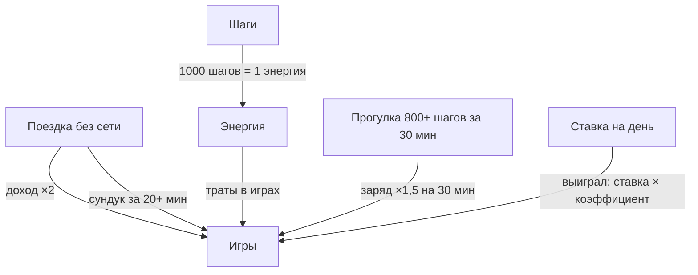

# Игротека

Игры на поездку: они идут без сети, копят, пока вас нет, и связаны с вашей жизнью — поездками, шагами, сном. Все цифры ниже — по умолчанию, каждую можно поменять в настройках Игротеки или самой игры.

## Каталог

- **Разделы:**
  - «Играю» — что открывали за неделю;
  - «Все игры»;
  - «На пробу» — пришли из «Игры дня»;
  - «Архив» — свёрнут.
- **Карточка:** значок, название, строка состояния из последнего сохранения и «был 2 ч назад». Метка «накопилось» появляется, если игра закрыта дольше часа.
- **Долгое нажатие на карточку:**
  - закрепить в меню, ярлык на рабочий стол;
  - сохранения, настройки игры, экспорт сохранения;
  - начать заново, в архив, удалить.
- **Новая игра** — кнопка «плюс». Скажите агенту, во что хотите играть, и он сделает игру.

> **Совет:** у каждой игры в меню (три точки вверху справа) есть «Как играть» и, если агент её написал, подробная «Инструкция».

## Пока вас не было

Закрытая игра продолжает копить. Когда вы вернётесь, лист «Пока вас не было» покажет, сколько набежало.

| Что | По умолчанию |
|:--|--:|
| Копится не дольше | 12 ч |
| Доля дохода без вас | 100 % |
| Сводка — если не было дольше | 1 мин |

## Связки с жизнью

### Пассажир

- **Когда в пути:** Аксико замечает поездку сам — по пропавшей сети, датчикам движения, спуску под землю и Wi-Fi метро. Если не заметил, нажмите «Я еду» на плашке.
- **Доход:** пока вы едете, все игры с этой связкой получают доход ×2.
- **Сундук:** за поездку от 20 минут — сундук, не больше двух в день.

### Шаги — топливо

- **Энергия:**
  - каждые 1000 шагов дают единицу, но не больше 15 в день;
  - запас — до 30 единиц;
  - неистраченная энергия сгорает через 2 дня.
- **Траты:** у каждой игры свои — раздуть горн, забрать офлайн ×2, поднять потолок офлайна на 2 ч. Без энергии игра тоже полностью играбельна.
- **Заряд прогулки:** 800 шагов за полчаса дают доход ×1,5 на следующие 30 минут.

### Ставка на день

- **Как ставить:**
  1. Утром (в 08:30) приходит напоминание.
  2. До 12:00 выбираете условие на день («10 000 шагов», «лечь до часа») и долю валюты игры: 10, 25 или 50 %.
  3. Вечером, в 23:30, ставка рассчитывается. Условия про сон проверяются в 10:00 следующего дня.
- **Коэффициент:** от 1,1 до 5, считается по вашей истории за 30 дней. Чем реже вы выполняли условие, тем он выше.
- **Серия:** три выигрыша подряд дают прибавку +0,1.

> **Важно:** поставить можно только то, что есть: при нуле валюты ставка не принимается.

## Контент от модели

- **Что заказывается заранее:** новые чудища, караваны, слова, рисунки клинков. Модель пишет их впрок, пока есть сеть: раз в 2 часа и за час до обычной поездки. Поэтому в метро всё уже готово.
- **Лимит:** не больше 30 запросов к модели в день. Неиспользованное хранится 30 дней.
- **Без сети:** когда запас кончился, игра берёт встроенный контент. По желанию его может готовить модель на телефоне.
- **Рисунки:** у игр с моделью-художником есть группа настроек «Рисунки» — вкл/выкл, анимация, сколько рисовать впрок, отсылки к фильмам и играм.

## Сохранения и ачивки

- **Сохранения:** игра сохраняется сама, старые версии хранятся. Откатиться можно из меню игры → «Сохранения».
- **Перенос:** выгрузить сохранение — долгое нажатие на карточку → «Экспорт сохранения». Загрузить обратно — «Импорт сохранения» в каталоге.
- **Ачивки:** собраны в меню игры. Отмеченные «за жизнь» уходят в модуль «Ачивки».
